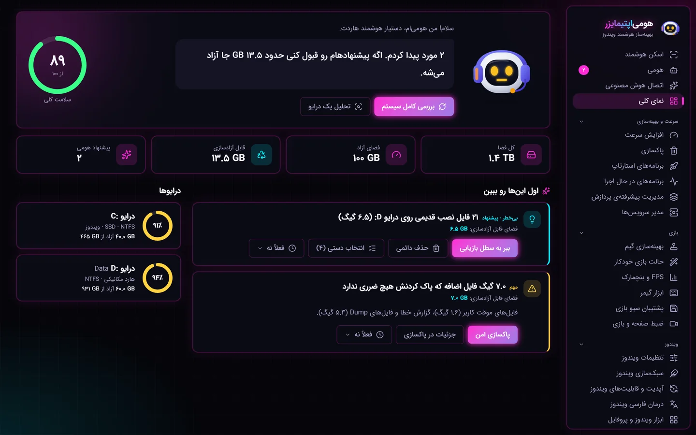
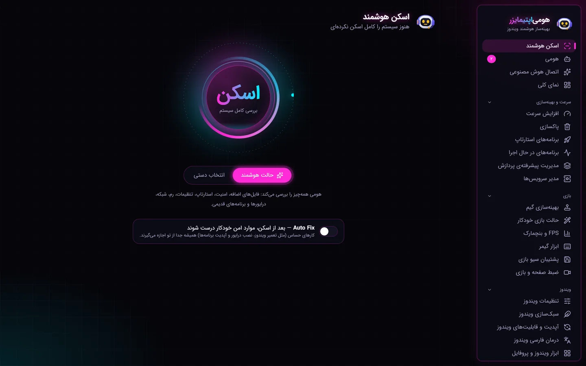
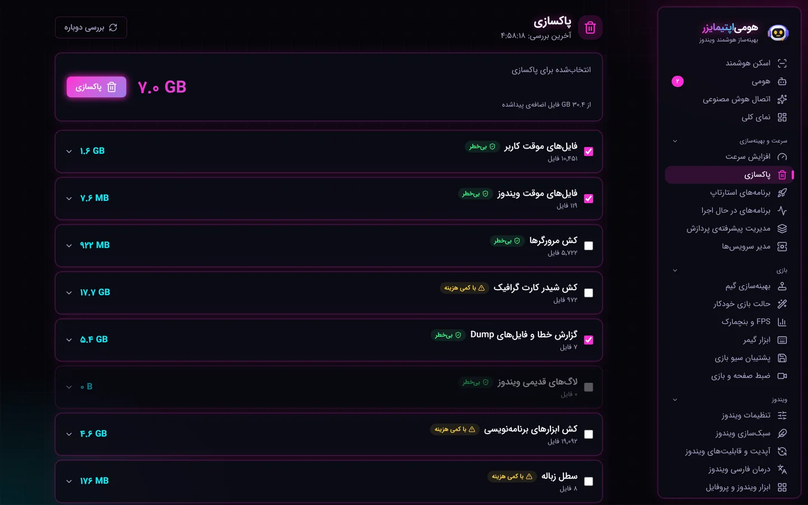
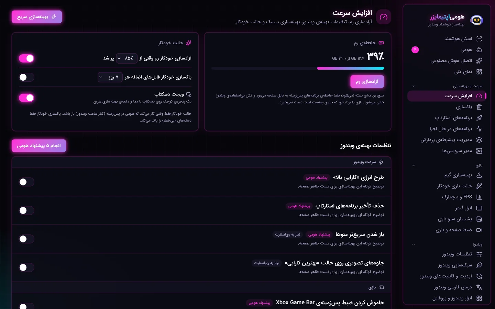
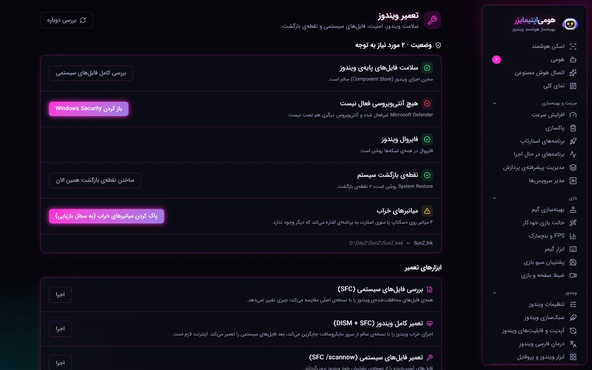
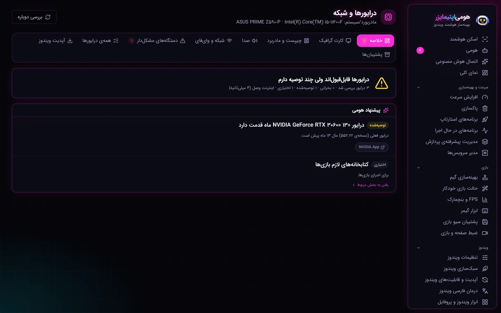
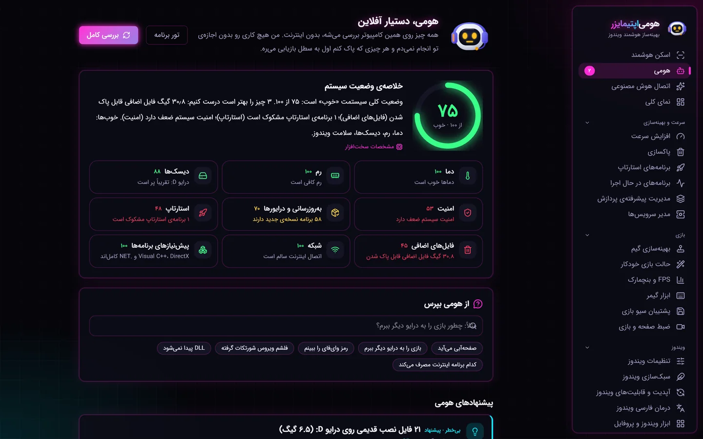

# هومی‌اپتیمایزر — HomiOptimizer

### بهینه‌ساز هوشمند و کاملاً فارسی ویندوز ۱۰ و ۱۱

اسکن هوشمند یک‌کلیکی · پاکسازی · افزایش سرعت و FPS بازی · تعمیر ویندوز · درایور · شبکه و DNS · سلامت دیسک · دستیار آفلاین «هومی»

**[🌐 مشاهده‌ی صفحه‌ی معرفی »](https://amir2139.github.io/HomiOptimizer/)** &nbsp;•&nbsp; **[⬇️ دانلود رایگان »](https://homioptimizer.ghalambartar.com/download/HomiOptimizer-0.2.2-setup.exe)**

---

**هومی‌اپتیمایزر (HomiOptimizer)** یک بهینه‌ساز همه‌کاره و سبک برای ویندوز است که همه‌ی کارهای نگهداری سیستم را در یک برنامه‌ی **کاملاً فارسی** و **راست‌به‌چپ** جمع کرده است. با یک کلیک کل سیستم را اسکن می‌کند، مشکلات را با زبان ساده توضیح می‌دهد و برای هرکدام راه‌حل یک‌کلیکی پیشنهاد می‌دهد — همه به‌صورت **آفلاین** و با احترام به حریم خصوصی.

## ✨ امکانات کلیدی

- 🔍 **اسکن هوشمند یک‌کلیکی** — بررسی کامل سیستم از نظر فایل اضافه، کندی، خطا و سلامت دیسک با امتیاز سلامت.
- 🧹 **پاکسازی فایل‌های اضافه** — Temp، کش ویندوز و مرورگرها، کش شیدر کارت گرافیک، لاگ‌ها و سطل بازیافت؛ بدون دست‌زدن به کوکی و رمز.
- ⚡ **افزایش سرعت و FPS بازی** — آزادسازی رم، حالت بازی، تنظیمات برگشت‌پذیر ویندوز و بهینه‌سازی دیسک.
- 🛠️ **تعمیر ویندوز** — ترمیم فایل‌های سیستمی (SFC/DISM)، نقطه بازگردانی، رفع ری‌استارت معلق و اسکن دیسک.
- 🔌 **درایور و بروزرسانی** — درایورهای مهم با لینک رسمی و بروزرسانی نرم‌افزارها با winget.
- 🌐 **شبکه، DNS و پینگ** — اصلاح DNS، ری‌ست Winsock و بررسی تأخیر و وضعیت اینترنت.
- 💽 **سلامت و فضای دیسک** — نقشه‌ی فضای مصرفی، بزرگ‌ترین پوشه‌ها، فایل‌های تکراری و وضعیت SMART.
- 🤖 **دستیار هوشمند «هومی»** — بعد از هر اسکن، مشکلات را توضیح می‌دهد و راه‌حل پیشنهاد می‌دهد؛ محلی، آفلاین و قابل‌توضیح.
- 🛡️ **امنیت و قرنطینه** — هر حذف اول به قرنطینه می‌رود و قابل بازگردانی است؛ مسیرهای حساس محافظت می‌شوند.

## 🖼️ تصاویر محیط برنامه

| اسکن هوشمند | پاکساز | سرعت و بازی |
|:---:|:---:|:---:|
|  |  |  |
| **تعمیر ویندوز** | **درایورها** | **دستیار هومی** |
|  |  |  |

## 💳 رایگان و پرو

| نسخه رایگان | نسخه پرو |
|---|---|
| اسکن کامل درایوها و نقشه‌ی فضا | هرچه در رایگان هست |
| شناسایی برنامه‌ها و بازی‌ها | پاکسازی، افزایش سرعت و بهینه‌سازی |
| دیدن همه‌ی مشکلات و پیشنهادهای هومی | تعمیر ویندوز، درایورها و شبکه |
| وضعیت سلامت دیسک (SMART) | انتقال/حذف کامل برنامه‌ها و اجرای راه‌حل‌های هومی |

> نسخه‌ی رایگان همه‌چیز را **اسکن و نشان می‌دهد**؛ انجام کارها در نسخه‌ی **پرو** باز می‌شود.

## ❓ سؤالات پرتکرار

**هومی‌اپتیمایزر رایگان است؟** بله؛ اسکن و نمایش همه‌ی مشکلات رایگان و بدون محدودیت است.

**آیا امن است؟** هر کار حذفی اول به قرنطینه می‌رود و قابل بازگردانی است؛ پیش از هر عملیات گروهی پیش‌نمایش نشان داده می‌شود.

**به اینترنت نیاز دارد؟** خیر، کاملاً آفلاین کار می‌کند. اینترنت فقط برای دانلود، بروزرسانی و درایورها لازم است.

**روی چه ویندوزهایی اجرا می‌شود؟** ویندوز ۱۰ و ۱۱، نسخه‌ی ۶۴ بیتی.

## 🔗 پیوندها

- 🌐 سایت رسمی: **[homioptimizer.ghalambartar.com](https://homioptimizer.ghalambartar.com/)**
- 📄 صفحه‌ی معرفی (GitHub Pages): **[amir2139.github.io/HomiOptimizer](https://amir2139.github.io/HomiOptimizer/)**
- ⬇️ دانلود مستقیم: **[HomiOptimizer-0.2.2-setup.exe](https://homioptimizer.ghalambartar.com/download/HomiOptimizer-0.2.2-setup.exe)**

---

**Keywords:** HomiOptimizer, هومی اپتیمایزر, Windows optimizer, بهینه ساز ویندوز, افزایش سرعت ویندوز, پاکسازی ویندوز, PC cleaner, game booster, افزایش FPS, تعمیر ویندوز, بروزرسانی درایور, کاهش پینگ, بهینه ساز فارسی, Persian Windows optimizer

© ۱۴۰۴ هومی‌اپتیمایزر — ساخته‌ی قلم‌برتر · تمام حقوق محفوظ است.

